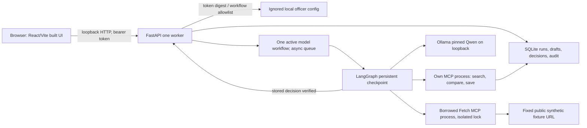

# Implemented local architecture

The API serves `frontend/dist` on loopback when built. It derives officer
identity and permitted workflow prefixes from a local token verifier; neither
the model nor the frontend bundle contains credentials. A request is stored
before the background integrated graph starts. Polling shows running, failed,
pending-review and completed states. New overlapping starts return 409 before creating a run; identical retries
return the existing run and changed-payload retries conflict. Previously
accepted runs recovering after a restart expose queued_for_model;
status and independent draft review remain responsive. Async API routes
dispatch synchronous SQLite work to threads so database waits do not block
checkpoint progress. A process restart can resume a stored
running request from its checkpoint.

The borrowed MCP process fetches only the pinned public synthetic fixture URL
under the application egress policy. Its verified snapshot and HTTP provenance
enter the own MCP subprocess. The model selects three own tools; deterministic
software validates the exact filters, quantity, comparison and immutable draft.
An officer decision is bound to workflow, draft, version and hash and is written
with audit in one SQLite transaction. The graph resumes only after that stored
decision is verified. `APPROVED` means internal review; no farmer messaging,
purchase or advisory delivery exists.

This is one local worker with a process-local model slot, workflow locks and
static high entropy demo tokens. A one-hour owner-authorized protected Quick
Tunnel forwards only the loopback app, with one exact email gate and a separate
scoped synthetic test-officer verifier. A connector-only hard watchdog ends
exposure; app/model services remain local and running. Remote phone login is
not established by local API checks. Multi-worker or persistent deployment
still needs shared recovery coordination, production identity, rate limits,
rights review and separate authorization. The source repository is public
following the owner's manual visibility change; historical data rights remain
unresolved. This app uses only project-authored synthetic records.

Qualifying-demo addendum: model context projects required quote/numeric fields
for latency; full immutable assumptions/source references are restored by the
host and validated again at the MCP server. All three tools remain available
for actual model selection. Authenticated, scoped tool-event endpoint feeds
live sanitized UI inputs/outputs/timestamps; events persist at drive exit,
with possible partial UI-event loss on abrupt crash before flush. Original
checkpoint/action/approval invariants remain unchanged. Demo reviewer label
is backend-derived; source/public access is not officer authority.
