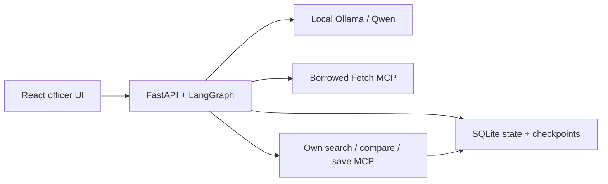

# SokoSignal — implemented synthetic prototype

**Intended workflow.** Extension officers supporting smallholder maize farmers
in Kenya compare quoted prices, harvest quantity, transport and other confirmed
costs, then review a sourced advisory. No office, adoption, partnership,
endorsement or practitioner validation is confirmed. Implemented runs use an
invented two-market maize fixture; only quantity is editable in the demo UI.

**Agent and boundaries.** One FastAPI worker runs a persistent LangGraph workflow.
Borrowed Fetch retrieves a commit-pinned public synthetic snapshot under exact
URL, DNS, redirect, size and hash controls. Local pinned Qwen selects among all
three discovered own MCP tools: `search_market_quotes`, `compare_market_options`
and `save_advisory_draft`. Numeric comparison uses deterministic Decimal rules.
The model cannot invent accepted references, change arithmetic or approve advice.

**Built versus borrowed.** We built quote/comparison validation, private immutable
drafts, authenticated decisions, recovery and the React evidence/tool UI. Fetch
2026.8.18 is an adapted upstream MCP server in its own locked environment: reuse
of its retrieval/robots implementation avoids recreating that protocol/parser;
our wrapper enforces the restricted destination policy. LangGraph, MCP SDK,
Ollama/Qwen and React/Vite are reused dependencies, separately licensed.

**Review and persistence.** Requests, drafts, decisions and checkpoints persist in
SQLite. A bearer verifier derives identity and workflow scope; decisions match
an exact pending version/hash. The graph verifies the stored decision before
resuming. Approval means internal review only; no farmer message, order or credit
action exists. Recorded approval is an authenticated automated demo identity,
not evidence of a named real officer. UI/API support approve/reject; request-changes
and revision UI remain unimplemented and disclosed in EVALS.

**Operational limits.** Distinct overlapping starts reject; identical retries are
idempotent and recovery serializes model work. Whitelisted live events contain
actual tool inputs/outputs/timestamps and persist on drive exit; abrupt pre-flush
crashes can lose UI event history. The app/model bind to loopback. The earlier
restricted tunnel expired. Reproduction was verified in a same-host fresh clone,
with new credentials/state and existing model/cache; no independent-host claim.
