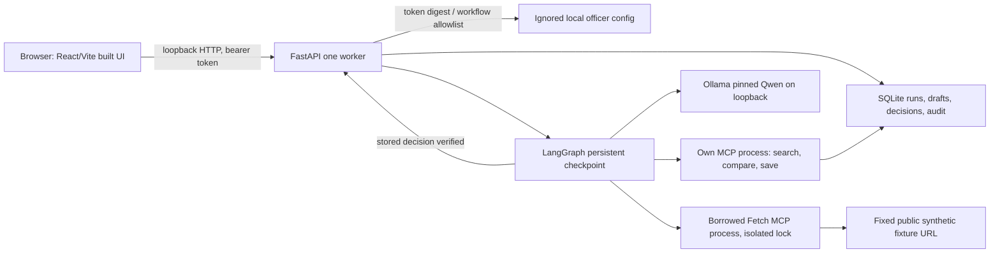

# Implemented local architecture

The API serves `frontend/dist` on loopback when built. It derives officer
identity and permitted workflow prefixes from a local token verifier; neither
the model nor the frontend bundle contains credentials. A request is stored
before the background integrated graph starts. Polling shows running, failed,
pending-review and completed states. A process restart can resume a stored
running request from its checkpoint.

The borrowed MCP process fetches only the pinned public synthetic fixture URL
under the application egress policy. Its verified snapshot and HTTP provenance
enter the own MCP subprocess. The model selects three own tools; deterministic
software validates the exact filters, quantity, comparison and immutable draft.
An officer decision is bound to workflow, draft, version and hash and is written
with audit in one SQLite transaction. The graph resumes only after that stored
decision is verified. `APPROVED` means internal review; no farmer messaging,
purchase or advisory delivery exists.

This is one local worker with process-local locks and static high entropy demo
tokens. Multi-worker/public deployment needs a shared recovery lock or outbox,
production identity, TLS, rate limits, rights review and a separate deployment
decision. The repository remains private pending the recorded publication
blocker.
