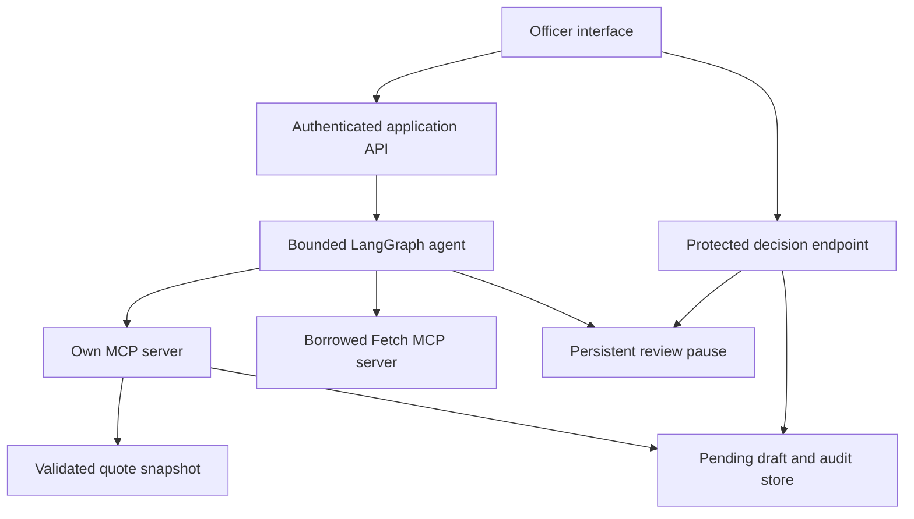

# Proposed architecture and shared contracts

Status: proposed, not implemented or benchmarked. A edits this contract; B reviews it before G1. Any later change includes a version, affected consumers, compatibility decision and tests. The final submission’s one-page `ARCHITECTURE.md` must describe what was actually built, not copy every proposal here.

## Flow and boundaries

Only the backend can authorize a reviewer decision. The agent may retrieve, compare and save a private draft; it cannot approve it. The interface reads authoritative server state. Neither the browser nor model can replace validated arithmetic. Saving a draft is the own-server action; it is private and not delivery to a household. Verify that this action satisfies the published tool requirement during the rules check.

Single-host prototype: one API worker, model service, two MCP subprocesses/services and persistent volumes. Decide exact transport in I01. Each server must be discoverable and called through actual MCP; an ordinary Python function with an MCP label does not count. Keep clients alive for the tool-call lifetime. No secrets or raw sensitive data are passed to tools.

## Proposed source tree — create during implementation only

| Path | Purpose | Lead |
|---|---|---|
| `backend/app/domain/` | Validation, units, comparisons, state invariants | A |
| `backend/app/services/` | Quotes, immutable drafts, decisions, audit | A |
| `backend/app/mcp/` | Own server and borrowed-server boundary | A |
| `backend/app/agent/` | Graph, model adapter, checkpoint and recovery | A |
| `backend/app/api/` | Typed API, local reviewer authentication | A |
| `backend/tests/` | Deterministic and real-protocol integration checks | A, B reviews |
| `frontend/src/` | Request, comparison, evidence and review interface | B |
| `frontend/tests/` | Interface states and critical browser workflow | B |
| `data/` | Licensed snapshots, manifests, clearly synthetic fixtures | B |
| `evals/` | Independent scenarios, expected answers, live-model runner/results | B |
| `infra/` | Container and launch configuration | A |
| `docs/data/`, `docs/runs/` | Source evidence and redacted run evidence | B |
| Root lockfiles, `Makefile`, `.github/workflows/` | Reproducibility and checks | A |

Commit code and small permitted artifacts, not model weights, virtual environments, node_modules, private database volumes or credentials. Configure `.gitignore` before these appear. Persist local runtime evidence separately and publish only reviewed redacted copies.

## Contract conventions

Use snake_case JSON fields, UUID identifiers and UTC RFC3339 timestamps. Price/cost/weight decimal values are strings in transport, converted to validated Decimal values server-side; do not silently accept NaN or infinity. Units are explicit. Currency uses a single selected ISO currency per comparison. Field errors are structured and actionable. Unknown is distinct from zero. Never treat a missing fee as free.

| Object | Required fields and rules |
|---|---|
| `Quote` | `quote_id`, `source_id`, `source_reference`, `commodity`, `variant`, `grade` (explicit unknown permitted), `market_id`, region, `sale_basis`, `price`, `currency`, `original_unit`, `unit_weight_kg` when required, `observation_date`, `retrieved_at`, `synthetic`; preserve raw input and normalization version |
| `SourceManifest` | Owner/site/reference, retrieval method/date, dataset hash, observation coverage, permission/licence evidence, attribution, allowed redistribution, transformations, contact/limitation note |
| `MarketScenario` | `market_id`, transport total, handling total, market fees total, cost currency, provenance/assumption for each; unknown costs remain null with a reason |
| `AdvisoryRequest` | Commodity/variant/grade, sale basis, positive `input_kg` or quantity plus confirmed conversion, coarse origin, candidate market IDs, `as_of_date`, explicit loss fraction in [0,1), market costs, request ID and user intent |
| `Comparison` | Accepted/excluded quote IDs and reasons, normalized price per kg, sellable kg, gross proceeds, costs, estimated net proceeds or null, ranking basis, tie/sensitivity flags, freshness and comparability policy version |
| `Draft` | Draft/run/request IDs, version, content hash, evidence snapshot hash, structured comparison, explanation, assumptions, limitations, `PENDING_REVIEW`, creator/time; source IDs must resolve to evidence |
| `Decision` | Draft/version/hash, approve/reject/request_changes, reason, idempotency key; reviewer identity and decision time are assigned by server |
| `RunEvent` | Event/run IDs, sequence, timestamp, event type, tool/server name, validated inputs, outputs/error, latency, model version, redaction metadata; tool traces and business decisions are distinguishable |

Avoid publishing real identities in evaluation artifacts. Internally retain the named reviewer required for audit; publicly use a consented demo identity or redact appropriately. Define what the institution permits before collecting personal data.

## Own MCP tools

| Tool | Input | Output | Side effects |
|---|---|---|---|
| `search_market_quotes` | Commodity, variant/grade, market IDs, sale basis, as-of date | Matching records, source manifests, exclusions and missing-data status | None |
| `compare_market_options` | Validated quote IDs/snapshot, quantity, explicit loss, explicit market costs, policy version | Deterministic gross/net comparison, invalid inputs, assumptions and evidence references | None |
| `save_advisory_draft` | Run/request IDs, validated comparison ID/hash, explanation, assumptions, unique action key | Draft ID/version/hash, pending state | Writes one private draft and audit event |

The save tool checks that the calculation and cited sources exist; it cannot accept arbitrary model-invented totals. Retry with the same action key and payload returns the same draft. Reusing a key with a changed payload returns a conflict. Model output is untrusted input. Schema validation applies both client-side and server-side.

Borrowed Fetch: retain upstream identity/licence/version; restrict invocation to exact approved public hosts and URLs necessary for the workflow. Block local/private/link-local targets and unsafe redirects at the application boundary. Respect upstream robots behavior. Cap timeout, response size and content length; treat retrieved text as data, never executable agent instructions. The legitimate workflow must actually invoke it to corroborate approved context or inspect an evidence gap. A URL pasted solely to inflate the tool count is not useful integration.

## Proposed API v1

| Route | Behavior | Access |
|---|---|---|
| `GET /health` | Application readiness without secrets | Local demo |
| `POST /api/v1/session` | Establish bounded named reviewer session using documented local credentials | Server validates; rate/attempt limits appropriate to demo |
| `POST /api/v1/requests` | Validate request and start/resume an explicitly identified run | Authenticated operator |
| `GET /api/v1/runs/{id}` | Status, errors, tool events and review reference | Authorized operator |
| `GET /api/v1/drafts/{id}` | Exact immutable version, evidence and current decision state | Authorized officer |
| `POST /api/v1/drafts/{id}/decisions` | Validate reviewer, current version/hash, permitted transition and idempotency key | Named reviewer only |

Freeze actual schemas/OpenAPI before parallel UI work. Choose and document session/token handling during I11; no credentials in query strings or browser source. If cookie sessions are used, include appropriate same-site/CSRF checks. Bind the demo locally by default. A public deployment needs an additional identity/network review; it is not required for a public repository and video.

## States and persistence

Run states: `CREATED`, `RUNNING`, `NEEDS_INFORMATION`, `PENDING_REVIEW`, `COMPLETED`, `FAILED`. Draft version states: `PENDING_REVIEW`, `APPROVED`, `REJECTED`, `CHANGES_REQUESTED`, `SUPERSEDED`. No-input/insufficient-evidence results may be reviewable, but cannot be approved as an actionable market recommendation.

Approval/rejection applies once to an exact pending version/hash. A revision creates a new immutable version; the old version is superseded and its prior approval does not carry over. Update decision and audit atomically, then resume the graph safely. A crash between decision and resume must recover from recorded state without duplicate actions. Check authorization before transitions, not only in the UI. Stale version → conflict; malformed fields → validation error; missing identity → unauthorized; wrong role → forbidden; missing record → not found. Duplicate identical decision → original result; conflicting repeated decision → conflict.

Proposed data tables: source manifests, normalized quotes, requests, comparisons, draft versions, decisions, audit events. Keep durable graph checkpoints managed by the chosen checkpointer with distinct migrations/namespaces. Unique action keys and decision constraints enforce repeat safety. Immutable snapshots include source/data hash and policy/model versions. Back up the non-sensitive demo state before recording; no backup containing credentials in the public repository.

## Numeric and evidence rules

One ranking compares the same commodity/variant, compatible grade, sale basis, currency, unit and defensible observation window. Unknown grade is flagged; it never silently equals a known grade. A confirmed 90 kg sack can be divided by 90; an unspecified sack cannot. Future observations relative to the request as-of date are invalid. Agree freshness policy with the practitioner; seven days is only a candidate to investigate, not a universal market rule. Historical replay uses its historical reference date, not the current clock.

Use the plan’s Decimal formula and explicit round-at-output policy. Total transport cost is charged once per market scenario. Per-unit charges are converted once. Missing costs allow a gross comparison only. Ties within the stated rounding precision have no unique winner. If plausible supplied cost ranges change the winner, explain uncertainty. Do not extrapolate missing prices or claim sale capacity from a quote.

Bound the agent’s tool calls, retrievals and retries; choose exact limits in I01 based on measured behavior. Timeout/validation errors become visible events. The model can clarify or save an insufficient-data draft; it must not label a failed run successful. Define a repeatable fallback when the model runtime is unavailable: clear failure state, preserved request, explicit retry, no fabricated result.

## I01.13 bounded implementation contract addendum — qualifying demo

The model adapter now projects quote/comparison outputs for latency: immutable
assumptions and source references remain host-owned and are restored from the
validated comparison before full advisory validation at both boundaries. Model
core numeric/winner/quote-ID/synthetic/pending fields must match exactly.
All three discovered own tools remain available each turn; no scripted
substitution, broadened task or authority is introduced. Output caps fail
closed on truncation. Actual borrowed retrieval still happens per new run.

Authenticated `GET /api/v1/runs/{id}/events` returns whitelisted synthetic
actual tool inputs/outputs/timestamps. Live events are process-local during
execution and persisted on drive exit in a separate run_events table. Abrupt
process death before flush can lose UI events; full local JSONL diagnostics
remain separate evidence. No headers, cookies, credentials or free model prose
are exposed. Existing HTTP request/draft/decision schemas remain compatible;
pending list adds backend-derived reviewer ID and demo label. Full draft
content, exact hashes, pending/review semantics and source provenance unchanged.

## I01.14 local timestamp presentation addendum

Status responses add nullable `started_at`, `completed_at`, `advisory_created_at`,
`officer_decision_at` and `officer_decision`. Events use persisted server UTC
RFC3339 offsets. New run start and terminal times are stored once; historical
start can resolve from persisted `pre_review_started_at`, but mutable `updated_at`
is never historical completion evidence. Draft creation and decisions resolve
from the exact current version. No decision means null decision/time. Source
`as_of_date` remains the synthetic observation date. UI formats workflow/tool
clock timestamps in Africa/Nairobi with EAT, uses `not available` for absent or
naive times, and preserves date-only source dates. Immutable quantity/unit comes
from the selected draft, never editable request state. See the
[local-only evidence](runs/I01.14-dashboard-dates.md); this addendum does not
change approvals, fixture, model, gate or release status.
